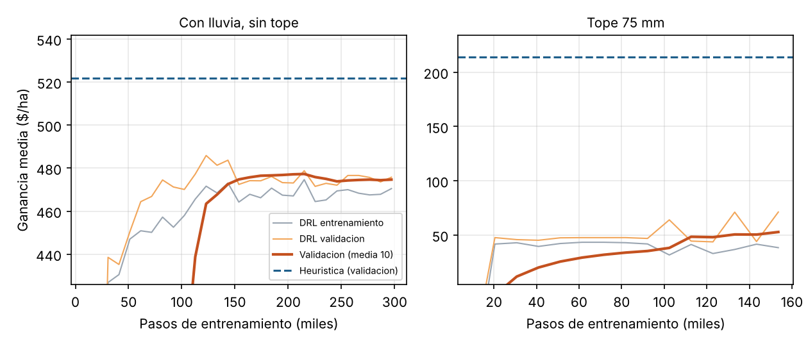
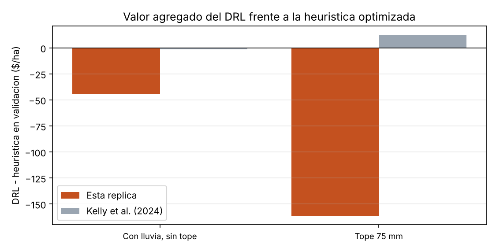
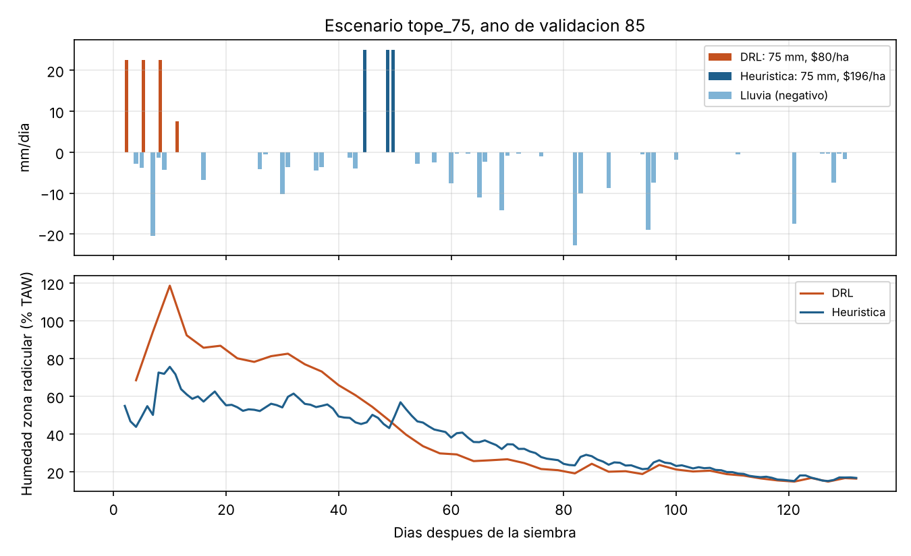

# Réplica: valor del Deep Reinforcement Learning para programar el riego

Prototipo que replica la experimentación de:

> Kelly, T. D., Foster, T., & Schultz, D. M. (2024). Assessing the value of deep reinforcement learning for irrigation scheduling. *Smart Agricultural Technology, 7*, 100403. https://doi.org/10.1016/j.atech.2024.100403

Curso Propuesta de Investigación 2026-2, Universidad de Lima. Autor de la réplica: Henry Wood Vargas.

## Qué se replica

El paper hace una pregunta concreta: **¿un agente de IA (DRL) programa el riego mejor que una buena regla simple?** Para responderla:

1. Usa un simulador físico de cultivo (AquaCrop-OSPy) como "entorno": maíz en 1 ha, Champion, Nebraska.
2. Genera clima sintético con LARS-WG: 70 años para entrenar y 30 para validar.
3. Entrena un agente PPO que cada 3 días decide cuánto regar (0 a 25 mm). La recompensa es la ganancia de la temporada:
   `ganancia = 180 $/t × rendimiento − 1 $/mm × riego − 1728 $/ha`
4. Lo compara con una **heurística optimizada**: 4 umbrales de humedad del suelo (uno por etapa del cultivo), ajustados con evolución diferencial para maximizar la ganancia.
5. Repite la comparación en escenarios de estrés hídrico.

Escenarios incluidos en este prototipo:

| Escenario | Qué cambia | Equivale a |
|---|---|---|
| `con_lluvia` | clima normal, sin límite de agua | Tabla 4, fila 1 |
| `tope_75` | máximo 75 mm de riego por temporada | Tabla 5, fila "75" |

El código también trae `sin_lluvia`, `tope_125` y `tope_100` (en `riego/escenarios.py`) por si se quieren correr.

## Resultados

Ganancia media en $/ha. "Validación" = los 30 años que el agente nunca vio. Para el DRL se reporta la mayor media móvil de 10 evaluaciones, igual que el paper.

| Escenario | Heurística (val) | DRL (val) | DRL − heurística | Paper: DRL (val) | Paper: DRL − heurística |
|---|---|---|---|---|---|
| Con lluvia, sin tope | 521.7 | 477.3 | −44.4 | 520.1 | −1.3 |
| Tope 75 mm | 214.0 | 52.8 | −161.2 | 228.0 | +12.2 |

En entrenamiento la heurística dio $514.0 (paper: $513) y $215.4 con tope de 75 mm. Los umbrales óptimos y el detalle por año están en `results/<escenario>/`.







**Lectura:** la parte de la línea base se replica con precisión: la heurística optimizada da prácticamente los mismos valores que el paper en ambos escenarios. La parte del DRL se replica solo parcialmente. Con lluvia, el agente queda por debajo de la heurística, que coincide en dirección con el paper ("el DRL no siempre supera a una heurística optimizada"), aunque la brecha es mayor. Con tope de 75 mm el agente no aprendió a guardar el agua: la gasta toda en los primeros días, mientras la heurística la reserva para floración (ver la figura de la demo). Así que **no** se reproduce el hallazgo de que el DRL agrega valor bajo restricción de agua.

La causa más probable es el presupuesto de entrenamiento (150 mil pasos frente a 1 millón del paper), no el entorno. Una regla simple dentro del mismo espacio de acciones del agente ("regar 10 mm solo en floración si falta agua") llega a unos $205/ha con tope de 75 mm, así que la estrategia buena sí es alcanzable. Aprenderla exige asignar el crédito de una recompensa que llega recién al final de la temporada, y eso necesita muchas más temporadas simuladas.

## Cómo funciona el código

```
riego/
  clima.py        carga el clima LARS-WG y calcula la ETo (FAO Penman-Monteith)
  entorno.py      entorno Gymnasium sobre AquaCrop-OSPy: observación, acción, recompensa
  escenarios.py   configuración de cada escenario + resultados del paper
  evaluacion.py   corre temporadas en años de entrenamiento y validación
scripts/
  optimizar_heuristica.py   evolución diferencial + Nelder-Mead sobre los 4 umbrales
  entrenar_drl.py           entrena PPO y evalúa cada 10 240 pasos (Fig. 2 del paper)
  resumen.py                arma la tabla comparativa y las figuras
  demo.py                   simula una temporada con el agente y la heurística
data/CPWG_100.dat           100 años de clima sintético publicados por los autores
results/<escenario>/        agente entrenado, curvas y resultados por año
```

El flujo de un episodio (una temporada):

1. `reset()` escoge un año de clima al azar (1 a 70) e inicializa AquaCrop el 1 de mayo.
2. Cada 3 días el agente recibe 18 variables: fecha, agotamiento de agua del suelo, días desde la siembra, riego acumulado, cobertura del dosel, biomasa, agua restante del tope, lluvia y ETo recientes y etapa de crecimiento.
3. Elige una lámina (0, 2.5, ... 25 mm), que se aplica y el simulador avanza 3 días.
4. Al cosechar, recibe la ganancia de la temporada (/1000) como recompensa.

## Cómo correrlo

Requiere Python 3.10 o superior.

```powershell
git clone https://github.com/HarrisitoWood/replica-kelly2024-riego-drl.git
cd replica-kelly2024-riego-drl
python -m venv .venv
.venv\Scripts\activate
pip install -r requirements.txt

# demo con los agentes ya entrenados (segundos)
python scripts/demo.py --escenario tope_75 --anio 85

# reproducir un escenario desde cero
python scripts/optimizar_heuristica.py --escenario tope_75      # ~25 min
python scripts/entrenar_drl.py --escenario tope_75 --pasos 153600 --n-steps 512 --batch 128 --gae-lambda 0.95 --ent 0   # ~25 min
python scripts/resumen.py
```

## Diferencias con el paper

| | Paper | Esta réplica | Por qué |
|---|---|---|---|
| Librería DRL | ray-rllib | stable-baselines3 (PPO) | rllib ya no es compatible con el código original |
| AquaCrop-OSPy | v1.1 | v3.1 | se portó el entorno a la API actual |
| Pasos de entrenamiento | 1 000 000 | 300 000 (`con_lluvia`) y 153 600 (`tope_75`) | se corrió en CPU de 2 núcleos, sin GPU |
| Optimización heurística | evolución diferencial | evolución diferencial + Nelder-Mead | con pocas iteraciones la evolución diferencial sola no convergía |
| Experimentos | 8 configuraciones + 5 escenarios | configuración ganadora (láminas discretas cada 3 días) + 2 escenarios | alcance del curso |

La validación del port: con los umbrales que publican los autores en su notebook, este entorno da $512.6 (entrenamiento) y $519.9 (validación), frente a $513 y $521 del paper.

## Créditos

Basado en el repositorio original de los autores, [aquacropos/aquacrop-gym](https://github.com/aquacropos/aquacrop-gym). El clima sintético (`data/CPWG_100.dat`) proviene de ese repositorio. Código de la réplica desarrollado con asistencia de IA (Claude), según lo permitido en el curso.
